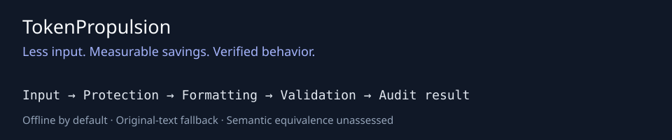

# TokenPropulsion

[](assets/tokenpropulsion-hero-8k.png)

[Repository](https://github.com/Ciprian-LocalPulse/tokenpropulsion) · [Whitepaper PDF](docs/whitepaper/TokenPropulsion-Whitepaper-v1.0.0rc1.pdf) · [Whitepaper source](docs/whitepaper/TokenPropulsion-Whitepaper-v1.0.0rc1.md) · [8K artwork](assets/tokenpropulsion-hero-8k.png)

**Less input. Measurable savings. Verified behavior.**

[](https://github.com/Ciprian-LocalPulse/tokenpropulsion/actions/workflows/ci.yml)


A dependency-free Python core for auditable prompt formatting, with optional official
xAI SDK integration, an authenticated REST service, and reproducible evaluation tools.
**Release candidate:** live xAI behavior remains unverified. The first hosted CI
matrix passed on Python 3.10-3.14; current results are linked below.
Hosted CI results are available in [GitHub Actions](https://github.com/Ciprian-LocalPulse/tokenpropulsion/actions).
The 8K artwork is an upscaled export; [asset provenance](assets/README.md) records native dimensions.

## The problem

LLM inputs often contain redundant formatting. Changing words or context to save tokens
can also change instructions, damage code, or weaken security boundaries. Savings must
be measured against a specified tokenizer and tested against the actual task.

## Why TokenPropulsion?

Predictable formatting changes, conservative whole-prompt protection, reversible audit
records, and clear separation between estimated counts and actual provider usage.
This release does not remove repeated instructions or claim semantic compression.

## Key features

- Zero required runtime dependencies; Python 3.10+.
- Low, medium, and explicit high formatting profiles; no external compression calls.
- Whole-prompt preservation for recognized code, structure, critical instructions,
  addresses, paths, math, sensitive markers, and unfamiliar Unicode scripts.
- Original text, stepwise before/after records, mechanical validators, and fallback.
- CLI, optional FastAPI factory, sync/async official xAI adapter, remote text tokenizer.
- Offline baselines, deterministic fixtures, and repeated opt-in remote experiments.

## How it works

1. Validate Unicode and the one-megabyte UTF-8 input limit.
2. Detect protected syntax. Any match preserves the entire prompt.
3. Trim trailing ASCII spaces (low); collapse excessive blank lines (medium);
   collapse repeated prose spaces (high).
4. Check ordered nonwhitespace units, protected identity, and nonincreasing token count.
5. Return original text on failed validation; expose every finding.

These checks establish mechanical invariants, **not semantic equivalence**. Even
formatting can carry meaning in natural language. Review changes and run task tests.
Medium adds only blank-line normalization: no context-aware word deletion has been
justified. High is deliberately limited to formatting too.

## Architecture



```text
CLI / Python / authenticated FastAPI
                |
 input limits -> whole-prompt protection -> formatting profiles
                |
 validators -> tokenizer protocol -> immutable result + audit trail
                |
 offline reports / explicit official xAI SDK adapter
```

See [architecture](docs/architecture.md), [evaluation](docs/evaluation.md), and
[release gates](docs/release.md).

## Installation

Until a package is published, install from this checkout:

```bash
python -m pip install .
python -m pip install '.[dev,api,xai]'  # optional development environment
```

The distribution name is provisional until reserved on PyPI. No runtime network access
occurs in the core. Optional dependency installation itself downloads packages.

## Quick start

```python
from tokenpropulsion import compress_prompt

result = compress_prompt("Explain stars.\n\n\nUse simple language.")
print(result.optimized_text)
print(result.tokenizer, result.counts_exact)  # estimate:utf8-bytes/4, False
assert result.restore() == result.original_text
```

## CLI examples

```bash
tokenpropulsion "Explain stars.   " --level medium --stats
tokenpropulsion -f input.txt -o output.txt
tokenpropulsion analyze -f input.txt
tokenpropulsion -f input.txt --json
tokenpropulsion benchmark --dataset benchmarks/datasets/sample.jsonl --repeats 10
cat input.txt | tokenpropulsion > output.txt
tokenpropulsion --help
```

Statistics go to stderr, optimized UTF-8 text goes to stdout. File and pipeline I/O
preserve line endings and protected content bytes. JSON/analyze exports include
prompt text and step records; store them carefully. Exit codes: 0 success, 1 broken
pipe, 2 invalid arguments/input/file/dataset. `analyze` and `benchmark` are reserved
positional commands; use `-f` or stdin for literal prompts with those exact names.
A benchmark fixture failure is recorded in `failure_cases`; CI checks that field.

## Python SDK usage

```python
from tokenpropulsion import compress_prompt
from tokenpropulsion.tokenizer import EstimatedTokenizer

r = compress_prompt(
    "Explain stars.   ", level="low", tokenizer=EstimatedTokenizer(bytes_per_token=3.5)
)
assert not r.semantic_equivalence_assessed
print(r.to_dict())  # contains original text: explicit caller-controlled persistence
```

Supply a `Tokenizer` protocol implementation with `identity`, `exact`, and `count(text)`.
The default UTF-8-byte estimate is configurable, language-sensitive, and uncalibrated;
it is neither exact model tokenization nor a guaranteed upper bound. A remote
tokenizer makes total `processing_seconds` include network time; keep it out of local
CPU benchmarks. Local benchmarks always use the offline estimate.

## xAI integration

Install `.[xai]`, set `XAI_API_KEY`, and choose a supported model in your own account.

```python
from tokenpropulsion.adapters.xai import XAIAdapter, XAITokenizer

adapter = XAIAdapter(model="YOUR_SUPPORTED_MODEL", allow_network=True, timeout=60, max_retries=0)
response = adapter.request("Explain stars.")
print(response.input_tokens, response.output_tokens, response.remote_seconds)
# async: response = await adapter.arequest("Explain stars.")
# Two billable requests: comparison = adapter.compare("Explain stars.   ")
# Remote text-only count: XAITokenizer(adapter).count("Explain stars.")
```

The adapter uses `Client`/`AsyncClient`, `chat.create`, `chat.sample`, returned usage,
and `tokenize.tokenize_text` from the official SDK. It disables stored chat messages,
sets a timeout and output cap, and uses bounded retries for transient gRPC failures.
Retries can incur duplicate charges. No retry is enabled by default. Keys and provider
exception details are never logged. SDK/provider telemetry and retention have separate
policies; inspect them before sending private data. Sensitive markers need a separate
`allow_sensitive=True`; detection is heuristic and does not replace dataset review.

Research references and tested SDK version: [xAI research](docs/xai-research.md).
Live requests have **not** been tested; mock tests cannot establish provider behavior.

## Optional REST service

```bash
# Generate a random ASCII token of at least 32 characters in your secret manager.
export TOKENPROPULSION_API_TOKEN='YOUR_RANDOM_TOKEN_AT_LEAST_32_CHARACTERS'
uvicorn tokenpropulsion.api.app:create_app --factory --host 127.0.0.1
```

All endpoints require `Authorization: Bearer ...`: POST `/compress`, POST `/analyze`
(JSON: `{"text":"Explain stars.   ","level":"medium"}`), GET `/health`, GET `/version`.
Docs and OpenAPI endpoints are disabled. The entire encoded request body is limited
to one megabyte before parsing, including chunked bodies. Compression/encoding is
rejected. Prompts are not retained. Configure TLS, rate limits, access-log policy,
request timeouts, and concurrency limits in your deployment proxy before exposure.

## Benchmarks and methodology

The [academic engineering whitepaper](docs/whitepaper/TokenPropulsion-Whitepaper-v1.0.0rc1.pdf)
contains exactly 10,000 counted body words, with references and editable Markdown source.
It documents architecture, threat models, evaluation, local evidence, and unresolved limitations.
It is an independent engineering paper, not a peer-reviewed publication.

```bash
python -m tokenpropulsion benchmark --dataset benchmarks/datasets/sample.jsonl \
  --repeats 10 -o benchmarks/results/local.json
pytest --cov=tokenpropulsion --cov-report=term-missing
```

The synthetic dataset covers nine task categories. The report compares unchanged
input, deliberately simple whitespace normalization, and protected formatting.
Dataset hashes identify input versions; timings are measured on the local machine
and vary. Results contain IDs and metrics, without prompt text. Offline output quality,
remote latency, real model-token reduction, and cost are explicitly null.

`run_remote` supports repeated pairs, alternating order, task-specific evaluators,
returned provider usage, failures, latency percentiles, and optional model-matched,
dated/sourced pricing. It is an explicit Python API, never an automatic CLI upload.
No prices are hardcoded. No live experiment or LLMLingua comparison is claimed.
LLMLingua adds model/dependency and licensing considerations; an independent future
comparison must record its version, model, hardware, license, and evaluator.
See [evaluation limits](docs/evaluation.md) and the generated local report.

## Limitations and safety

- Protection is broad and heuristic, not a proof that all unrecognized syntax is safe.
- Many inputs remain unchanged, and measured savings may be zero.
- No semantic-equivalence assessment; all results say so explicitly.
- No repeated word/instruction removal, model-based compression, or hierarchy rewriting.
- The default estimate cannot establish billing savings. Provider usage can vary due
  to caching, envelopes, reasoning, and model revisions.
- Audit results contain prompts in memory. CLI JSON and explicit output files retain
  them only when requested. No persistent history or logging is implemented.
- The API is a single-process service component, not a complete public hosting platform.

## Roadmap

Task-validated redundancy rules, pluggable local model tokenizers, broader independent
quality datasets, a pinned LLMLingua comparison, and live xAI compatibility gates.

## Contributing

See [CONTRIBUTING](CONTRIBUTING.md) and [CODE_OF_CONDUCT](CODE_OF_CONDUCT.md).
Changes to transformations need adversarial fixtures and evidence for their safety.

## Security

See [SECURITY](SECURITY.md). Do not put credentials or private prompts in issues.

## License

[MIT](LICENSE), copyright Ciprian Ștefan Pleșca. Optional libraries retain their own
licenses; no third-party source code is vendored.

## Author and acknowledgments

Created by **Ciprian Ștefan Pleșca**. Thanks to the Python community and the maintainers
of the optional official xAI SDK and the testing/build/security tools.

## Independent project disclaimer

TokenPropulsion is an independent community project. It is not affiliated with,
endorsed by, or sponsored by xAI, SpaceX, or Elon Musk. Product and company names
belong to their respective owners. Naming checks are preliminary, not legal clearance.
