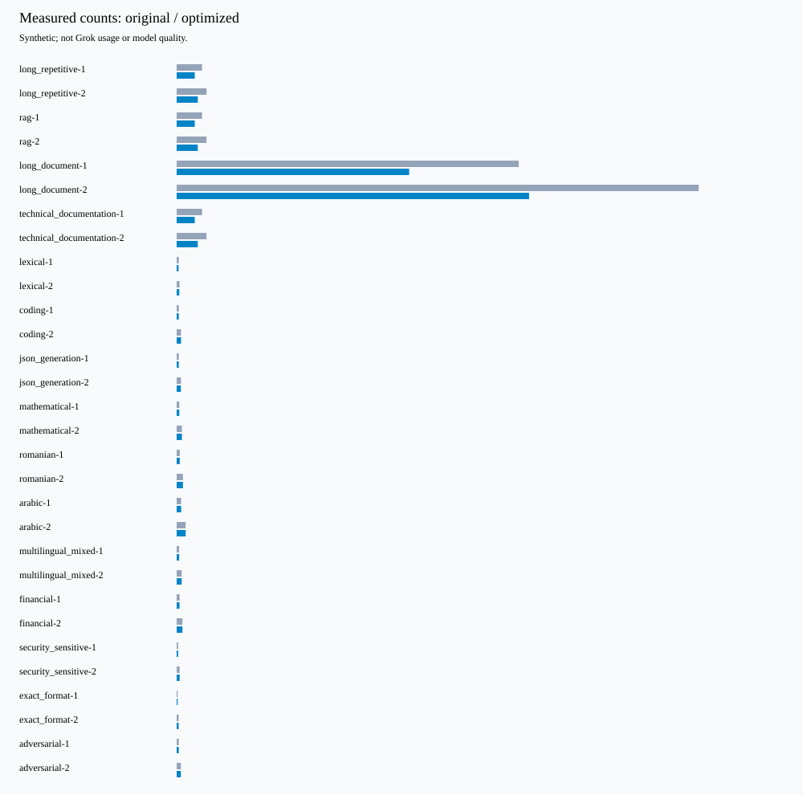

# TokenPropulsion 2.0

[](assets/tokenpropulsion-hero-8k.png)

[](https://github.com/Ciprian-LocalPulse/tokenpropulsion/actions/workflows/ci.yml)
  

[Live recorded demonstration](https://ciprian-localpulse.github.io/tokenpropulsion-site/#demo) · [35-second technical video](https://ciprian-localpulse.github.io/tokenpropulsion-site/assets/tokenpropulsion-demo-16x9.mp4) · [Ecosystem audit](AUDIT/ECOSYSTEM_FINAL_REPORT.md)

Auditable prompt compression with a dependency-free Python core, explicit task contracts,
conservative fallback, and optional xAI, REST, tokenizer and local embedding integrations.
**Research alpha: not production ready.** No live xAI study has been executed.

[2.0 whitepaper](docs/whitepaper/TokenPropulsion-Whitepaper-v2.0.0a1.pdf) · [Research and migration](docs/research-v2.md) · [Audit](AUDIT/RELEASE_READINESS.md) · [Measured results](benchmarks/results/v2.0.0a1/performance_summary.md) · [Original 10,000-word paper](docs/whitepaper/TokenPropulsion-Whitepaper-v1.0.0rc1.pdf)

## Measured evidence

The project-authored synthetic dataset has 30 cases in 15 categories. With exact
**cl100k_base** counting, input length decreased **8,871 → 6,249 tokens (29.557%)**.
This tokenizer is unrelated to the selected Grok model. These are not Grok usage or
billing measurements. Long repeated-context cases dominate the token-weighted total;
20 protected cases remain unchanged. All declared deterministic task contracts passed.
This does not measure model answer quality or universal semantic equivalence.

Local compression overhead: mean **2.450 ms**, p50 **0.161 ms**, p95 **23.379 ms**
(10 repeats per case, Windows/Python 3.12). See the [raw report](benchmarks/results/v2.0.0a1/optimized.json)
for timing variance and descriptive confidence interval. Real-world corpus evaluation,
live provider output quality, remote latency, TTFT and invoice savings remain unmeasured.



## Installation and examples

```bash
python -m pip install .                       # zero required runtime dependencies
python -m pip install '.[api,xai,tokenizers]'  # optional integrations
python -m pip install '.[dev,api,xai,tokenizers]' # development checks
```

No PyPI release has been made. Install this reviewed checkout or a GitHub release wheel.

```python
from tokenpropulsion import compress_prompt, ContextSection, PromptDocument, compress_document

result = compress_prompt("Explain stars.   ")  # existing API remains supported
assert result.restore() == result.original_text
assert result.saved_percent == result.tokens_saved_percent

section = ContextSection("source-a", "Stars emit light.", idempotent=True)
document = PromptDocument("Summarize the context.", (section, section), "What emits light?")
result = compress_document(document)
print(result.optimized_text, result.validation_scope)
```

Mark context idempotent only when multiplicity has no task meaning. Source identity,
order, untrusted boundaries, instructions and question are retained. Protected context
text is never deduplicated. Documents serialize as JSON; this is a separate explicit API.

```python
from tokenpropulsion.strategies import TaskValidator

validator = TaskValidator(
    "paragraph-set", lambda a, b: set(a.split("\n\n")) == set(b.split("\n\n"))
)
result = compress_prompt("Stars shine.\n\nStars shine.", level="adaptive", task_validator=validator)
```

This validator declares set semantics; it is unsuitable for tasks where repetitions
matter. Caller-owned validators must assess the actual task, not return a constant.

## Strategies and safety boundaries

| Strategy | Behavior | Acceptance and status |
|---|---|---|
| Conservative | Existing low/medium/high formatting | Mechanical checks; default |
| Structural | Exact paragraph duplicates | Explicit task validator required |
| Structured document | Duplicate declared idempotent context | Independent document-contract validation |
| Lexical | Four small phrase substitutions | Explicit task validator; experimental |
| Semantic | Optional local SentenceTransformer candidate | Local weights + task validator; stub-tested only |
| Reversible | Bounded zlib/base64 transport envelope | Exact decoder required; not a model-readable prompt |

Adaptive selects conservative formatting unless a supplied task validator and duplicate
paragraphs permit structural reduction. It never automatically invokes embeddings or a
remote model. All accepted candidates must have nonincreasing counts with the same
counter. Code, math, structured syntax, critical instructions, security-sensitive markers,
financial, medical and legal content receive conservative whole-prompt protection.
Recognition is bounded pattern matching, not a complete sensitive-content detector.

Token metadata separates provider-exact, verified-compatible local, unrelated local,
heuristic and custom-unspecified counts. No verified-compatible Grok local tokenizer
is supplied. tiktoken is explicitly unrelated. Its initial vocabulary download requires
an explicit opt-in; core compression performs no network I/O.

## CLI and optional service

```bash
tokenpropulsion version
tokenpropulsion doctor
tokenpropulsion compress 'Stars shine.   '
tokenpropulsion analyze 'Stars shine.   '
tokenpropulsion compare 'Stars shine.   '
tokenpropulsion benchmark --dataset benchmarks/datasets/evaluation.jsonl --report new-report --repeats 10
# Exact local vocabulary count (explicit initial tokenizer download):
tokenpropulsion benchmark --dataset benchmarks/datasets/evaluation.jsonl --tokenizer tiktoken --allow-tokenizer-download --report new-exact-report
```

Existing flat CLI arguments remain supported. Reports refuse nonempty destinations.
REST: `tokenpropulsion.api.app.create_app(api_token=...)` requires an ASCII bearer token
of at least 32 characters, limits input to 1 MB, rejects content encoding and extra JSON
fields, uses a 10-second body timeout and a per-process request limiter. Deploy behind
TLS, external concurrency limits and a shared rate limiter when using multiple workers.
No prompts are persisted by the service itself; hosting logs remain operator-controlled.

## Optional xAI experiments

Official SDK sync/async requests expose provider usage, cached input tokens and reported
cost when available. Live experiments require model selection, network permission,
billing authorization and local reservation limits. No key or paid request was used for
this release. Reservations are not a guaranteed provider-side spending cap; configure
provider account limits. Retries can incur charges. See [experiment guidance](docs/research-v2.md).

```bash
tokenpropulsion benchmark --provider xai --model YOUR_REVIEWED_MODEL --compare --dataset benchmarks/datasets/remote_smoke.jsonl --allow-network --authorize-billing --budget-usd 0.10 --reserve-usd-per-request 0.01 --max-requests 10 --repeats 2
```

Never use private production prompts in an unreviewed remote study. The optional judge
is a separately authorized observation, cannot approve transformations, and may be wrong.

## Validation and preserved history

Run `pytest --cov=tokenpropulsion`, `ruff check .`, `ruff format --check .`, `mypy`,
`bandit -r src`, `pip-audit`, `python -m build`, and `twine check dist/*`.
CI covers Python 3.10-3.14. Full evidence and limitations are in [AUDIT](AUDIT/FINAL_TECHNICAL_AUDIT.md).
The v1 paper, historical reports and v1 release remain intact; [historical README](docs/README-v1.0.0rc1.md)
contains the original introduction. The 16:9 8K image is an upscaled export;
[asset provenance](assets/README.md) records its native dimensions.

MIT · Ciprian Ștefan Pleșca, Independent Developer & Researcher.
Independent community project; no affiliation with xAI, SpaceX or Elon Musk.
